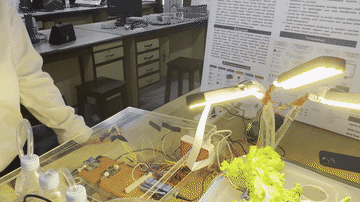
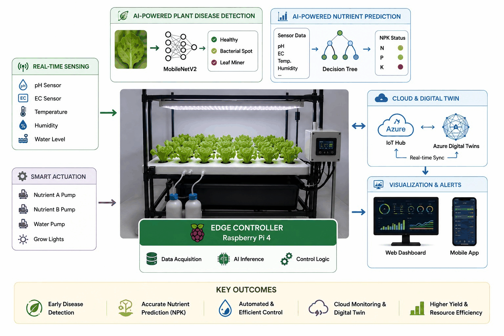
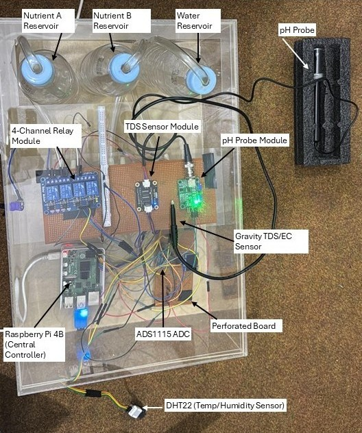
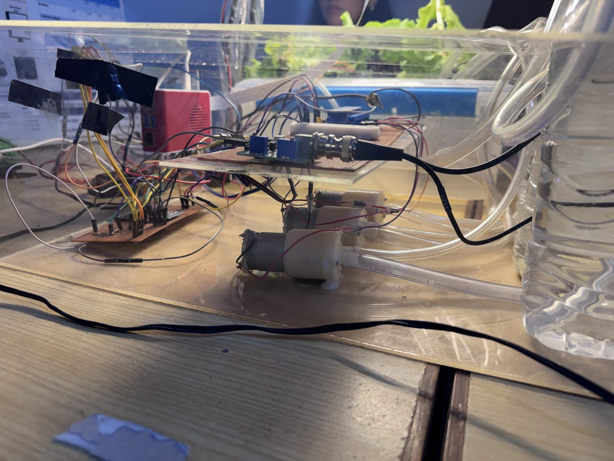
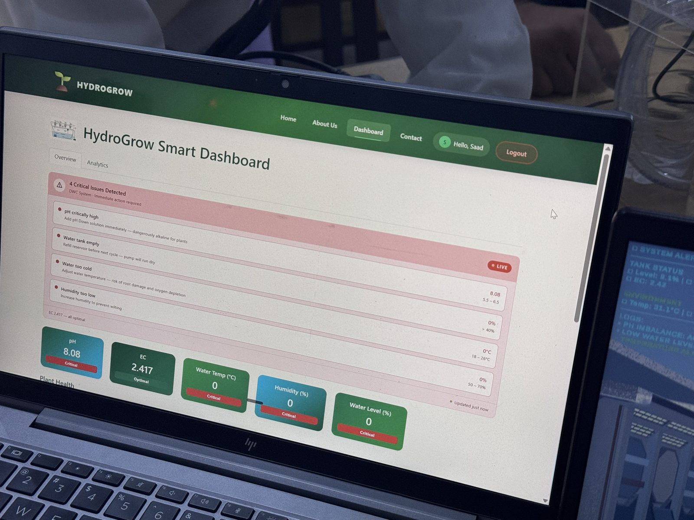
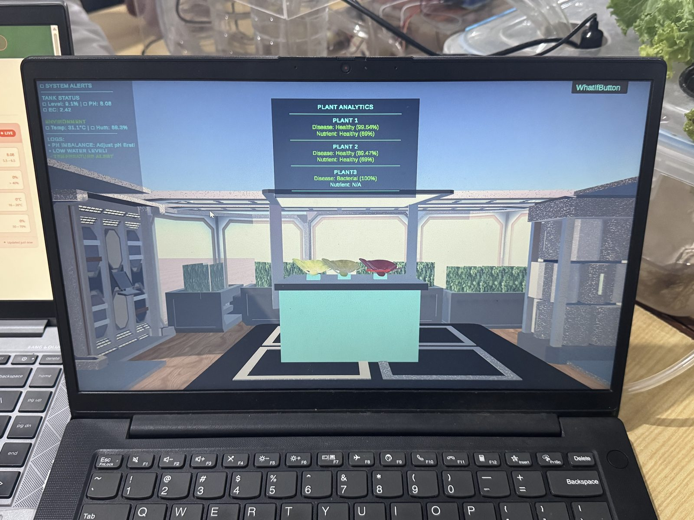

# HydroGrow

**A hydroponic lettuce farm that senses, decides, and doses itself.**

Raspberry Pi reads pH, EC, temperature, humidity and water level on a supervisory
loop (30 minutes by default, 30 seconds in the Local Edition). Two ML models run
on-device: one classifies leaf disease from camera frames, one predicts nutrient
deficiency from sensor state. The Pi acts on those predictions by firing dosing
pumps, then streams everything to a Digital Twin and a live dashboard, through
Azure (cloud edition) or entirely on the Pi (Local Edition).

Built, wired, calibrated, and run on a live grow. Presented at the 10th Pakistan
Industrial Expo, Nov 2026.

[Architecture](docs/architecture.md) · [Results](docs/results.md) · [Hardware](docs/hardware.md) · [Dosing logic](docs/dosing-logic.md)



## What it does

- **Senses.** Five sensor channels through an ADS1115 ADC and Pi GPIO, sampled once per supervisory cycle.
- **Decides.** A Random Forest classifier maps live sensor state to a nutrient
  deficiency class. A MobileNetV2 classifier scores three plant regions from a single
  camera frame for bacterial infection and Septoria blight.
- **Acts.** Three peristaltic pumps dose macronutrients, micronutrients, and water.
  Dosing is gated on EC, model confidence, and growth phase. Nutrients dose before
  water top-up so concentration lands correctly.
- **Reports.** In the cloud edition, telemetry goes Pi to IoT Hub to Azure Function to
  Blob Storage to Express API to React dashboard, and in parallel into an Azure Digital
  Twin that a Unity 3D scene mirrors in real time. The Local Edition replaces the Azure
  hops with Mosquitto, a Python ingest service and SQLite, and serves the same API and
  twin documents from the Pi.

The dosing loop is the part that matters. Most hydroponic IoT projects are
dashboards with sensors attached. This one closes the loop and moves liquid.

## Two ways to run it

| | Cloud edition | Local Edition |
|---|---|---|
| Runs on | Azure: IoT Hub, Functions, Blob Storage, Digital Twins, App Service | One Raspberry Pi, or a laptop with a simulated Pi |
| Status | Retired infrastructure: the subscription is gone; code and runbook kept for reference | Current; used at the expo |
| Transport | `HYDROGROW_TRANSPORT=azure` (IoT Hub) | `HYDROGROW_TRANSPORT=mqtt` (default, local Mosquitto) |
| Storage | Blob Storage + Azure Digital Twins | SQLite on the Pi |
| Needs internet | Always | Only once, to install |
| Code | `cloud/`, `backend/`, `dashboard/` | `local-edition/` (reuses `firmware/` and `dashboard/`) |
| Docs | [docs/deployment.md](docs/deployment.md) | [local-edition/docs/START_HERE.md](local-edition/docs/START_HERE.md) |

Both editions run the same `firmware/main.py`, and the Local Edition serves the same
API shapes and twin documents, so the dashboard and the Unity scene work against either.
Details: [local-edition/docs/ARCHITECTURE.md](local-edition/docs/ARCHITECTURE.md).

## Architecture



The diagram and table below show the cloud edition.

| Layer | Stack | Responsibility |
|---|---|---|
| Edge | Raspberry Pi 4B, Python | Sensor reads, ML inference, pump control, OLED status |
| Transport | Azure IoT Hub, MQTT over TLS 8883 | Device auth and message ingestion |
| Processing | Azure Functions (Python) | Telemetry persistence, analytics API |
| Storage | Azure Blob Storage | Timestamped JSON per reading |
| Twin | Azure Digital Twins | Live model of tank, environment, and each plant |
| API | Node 20, Express | Serves the SPA, proxies analytics, exposes /pidata |
| UI | React | Live cards, trend charts, per-plant health with confidence bars |
| Visualization | Unity 3D | 3D twin driven off the Digital Twins graph |

Full hop-by-hop breakdown: [docs/architecture.md](docs/architecture.md)

## Results

### Leaf disease classifier

MobileNetV2 transfer learning, 15 epochs. One camera frame is cropped into three
fixed regions and scored independently, so a single Pi Camera covers three plants.

Held-out test set: 569 images.

| Class | Precision | Recall | F1 | Support |
|---|---|---|---|---|
| Bacterial | 0.93 | 0.92 | 0.92 | 172 |
| Healthy | 1.00 | 0.96 | 0.98 | 224 |
| Septoria blight | 0.92 | 0.98 | 0.95 | 173 |

**Overall accuracy 95.25%** · Macro F1 0.9501 · Weighted F1 0.9528

Classes are near-balanced (172 / 224 / 173), so overall accuracy is not masking a
majority-class effect. Precision of 1.00 on Healthy with recall 0.96 means the
model never calls a diseased plant healthy but occasionally flags a healthy one,
which is the correct direction to err for an actuating system.

Confusion matrix and training curves are generated by the notebook but not yet
exported into the repo; see [docs/results.md](docs/results.md).

### Nutrient deficiency classifier

Predicts Healthy / Nitrogen / Phosphorus / Potassium deficient from sensor
features. Stratified 80/20 split, 48-sample test set.

| Model | Accuracy | Weighted F1 |
|---|---|---|
| Random Forest (shipped) | 97.92% | 0.9788 |
| Gradient Boosting | 97.92% | 0.9788 |
| SVM (RBF) | 97.92% | 0.9788 |
| Decision Tree | 95.83% | 0.9583 |
| KNN | 89.58% | 0.8932 |

The deployed model is a 100-tree Random Forest on 10 features (pH, EC, estimated
N/P/K, air temperature, humidity, water level, growth day, treatment %). The
table above comes from a comparison run on a closely related feature set.

Per-class on the shipped model: Healthy 1.00 F1, Phosphorus 1.00, Potassium 0.94,
Nitrogen 0.91. Nitrogen recall (0.83) is the weak point, one of six nitrogen
samples is misread as potassium deficient.

**Methodology note.** Training data is a 240-row simulated dataset (60 days x 4
plants) built to match physical sensor ranges and realistic deficiency dynamics.
It is not field-labelled. Because rows are consecutive days from the same plants,
a random split places adjacent days from one plant on both sides of the split, so
these figures should be read as an upper bound rather than a clean generalization
estimate. Grouped cross validation by plant lands closer to 95%. Notebook and
dataset assumptions: [ml/nutrient-prediction/](ml/nutrient-prediction/)

### On-device performance

Not yet measured on the Pi; see the Roadmap.

## Hardware





Full BOM, pinout, and the wiring lessons (relay drive current, ultrasonic
inversion, ECHO divider): [docs/hardware.md](docs/hardware.md)

## Dashboard



Live sensor cards and alerting, viewed mid-grow-cycle.

## Digital Twin



Per-plant disease and nutrient status over live tank telemetry, mid-session.

## Quickstart

### Local Edition: Demo Mode on a laptop (no hardware)

Needs Node.js 22 and Python 3.10+. Run each long-running command in its own terminal,
from the repo root. On Windows, use Git Bash or PowerShell 7: Windows PowerShell 5.1
(the built-in `powershell.exe`) rejects `&&`, so there run each `&&`-joined part as its
own line, in order.

```bash
cp local-edition/.env.example local-edition/.env      # set DEMO_USER_PASSWORD
python -m pip install -r local-edition/ingest/requirements.txt

cd local-edition/tools && npm ci && npm run broker    # 1: MQTT broker
python local-edition/ingest/ingest.py                 # 2: MQTT -> SQLite
cd local-edition/dashboard && npm ci && npm run build && cd ../backend && npm ci && npm start   # 3: dashboard + API on :8080
python local-edition/tools/fake_pi.py                 # 4: simulated Pi
```

Open http://localhost:8080/ and log in as `demo@hydrogrow.local` with the
`DEMO_USER_PASSWORD` you set. The badge reads **Simulated**. `fake_pi.py --scenario low_ec`
(or `high_ph`, `low_water`, `diseased`, `flaky_dht`) changes the alerts.
`python local-edition/tools/replay.py <recordings>` (stop `fake_pi.py` first) replays
recorded readings under a **Demo Mode** badge. No recordings ship with the repo: pass your
own folder of `YYYYMMDD_HHMMSS_us.json` payloads, a `.jsonl` file or a `.json` list, for
example the `raw_json` column of the `telemetry` table in a Pi's SQLite database. Full walkthrough:
[local-edition/docs/START_HERE.md](local-edition/docs/START_HERE.md).

### Local Edition: on a Raspberry Pi

Raspberry Pi 4B, Raspberry Pi OS 64-bit (Debian 13 trixie), the rig wired as in
[firmware/README.md](firmware/README.md). Internet is needed once.

```bash
git clone https://github.com/Mr-Engnr/hydrogrow.git
cd hydrogrow
sudo bash local-edition/setup.sh
```

`setup.sh` asks for the planting date and a dashboard password, installs everything
(pinned Python packages, models with SHA-256 checks, Mosquitto, Node, systemd services),
reboots once, runs a hardware test and ends with a PASS/FAIL table. Pumps start in dry
run until you switch them on. Show-day operation and recovery:
[local-edition/docs/EXPO_RUNBOOK.md](local-edition/docs/EXPO_RUNBOOK.md).

### Demo Mode honesty note

Demo data is simulated (`fake_pi.py`) or replayed from recordings (`replay.py`), and the
dashboard labels it **Simulated** or **Demo Mode**. Only readings from the real firmware
show as **Live**, and no setting can change that. The pH probe was unavailable at the
expo, so pH values shown there were not live probe measurements.

### Cloud edition (retired infrastructure)

Kept for reference; the Azure resources it talks to no longer exist. To run the firmware
against your own IoT Hub:

```bash
git clone https://github.com/Mr-Engnr/hydrogrow.git
cd hydrogrow
python -m venv .venv && source .venv/bin/activate
pip install -r firmware/requirements.txt azure-iot-device
cp firmware/config/settings.example.yaml firmware/config/settings.yaml
python firmware/tests/test_hardware_full.py  # bring-up: verify each sensor/pump
HYDROGROW_TRANSPORT=azure IOTHUB_CONNECTION_STRING="<device connection string>" python firmware/main.py
```

Model weights: download the disease model from the [v1.0.0 release](https://github.com/Mr-Engnr/hydrogrow/releases/tag/v1.0.0); see [firmware/README.md](firmware/README.md#running) for the curl command.

Dashboard and API (needs the Azure resources from [docs/deployment.md](docs/deployment.md)):

```bash
cp .env.example .env
docker compose up
```

Dashboard on http://localhost:3000, API on :8080.

## Repo map

| Path | What lives here |
|---|---|
| firmware/ | Pi control loop, sensor drivers, dosing logic, on-device inference; MQTT or Azure transport (`HYDROGROW_TRANSPORT`) |
| ml/ | Training notebooks, trained nutrient model |
| cloud/ | Cloud edition: Azure Functions, Digital Twin models, provisioning scripts |
| backend/ | Cloud edition: Express API and static host |
| dashboard/ | React SPA (cloud edition; the Local Edition builds on top of it) |
| local-edition/ | Local Edition: broker config, ingest, SQLite backend, dashboard overrides, simulators, Pi installer, docs |
| docs/ | Architecture, hardware, calibration, dosing math, deployment, results |
| media/ | Photos, diagrams, dashboard and twin captures |

## Roadmap

- [x] Hardware-free demo of the full stack: simulated (`fake_pi.py`) and replayed (`replay.py`) telemetry, labeled in the UI
- [ ] Hardware-free mock mode for the control loop itself (`main.py` still needs the Pi's sensor and camera libraries)
- [ ] On-device latency benchmarks on Raspberry Pi
- [ ] Growth-cycle photo timeline from the next grow run
- [ ] Two-point pH calibration on a scheduled cadence, drift logged as telemetry
- [ ] Volume-based dosing using measured pump flow rate
- [ ] Retrain the disease model on images captured by this rig
- [x] Persist users in a real database instead of a file store (Local Edition: SQLite)
- [ ] Closed-loop pH correction with an up/down dosing pair

## Known limits

- Nutrient model trains on simulated data. See the note in Results.
- The control loop runs on a 30-minute supervisory cycle by default. The Local Edition
  reads sensors every 30 s but still doses at most once per 30 minutes, and runs the
  camera every 5 minutes.
- Auth is opaque random bearer tokens stored server-side (not JWT), single-operator
  grade, not multi-tenant. The cloud edition keeps users in a file; the Local Edition
  keeps them in SQLite and seeds one demo user from its env file. Registration is still
  open, so on a shared network anyone who can reach the dashboard can create an account.
- The Local Edition's MQTT broker and read endpoints are anonymous by design (isolated
  LAN); [local-edition/docs/ARCHITECTURE.md](local-edition/docs/ARCHITECTURE.md) says how to lock them down.
- Dosing is time-based; accuracy depends on pump flow staying stable.
- The original Azure deployment ran on a now-retired subscription. Everything is
  reproducible on any subscription following the runbook in
  [docs/deployment.md](docs/deployment.md); media/ shows the system live. The Local
  Edition needs no subscription.

## Credits

Built by Rana Saad Safdar - hardware, firmware, ML, cloud, backend, dashboard.

## License

Apache 2.0. See [LICENSE](LICENSE).
